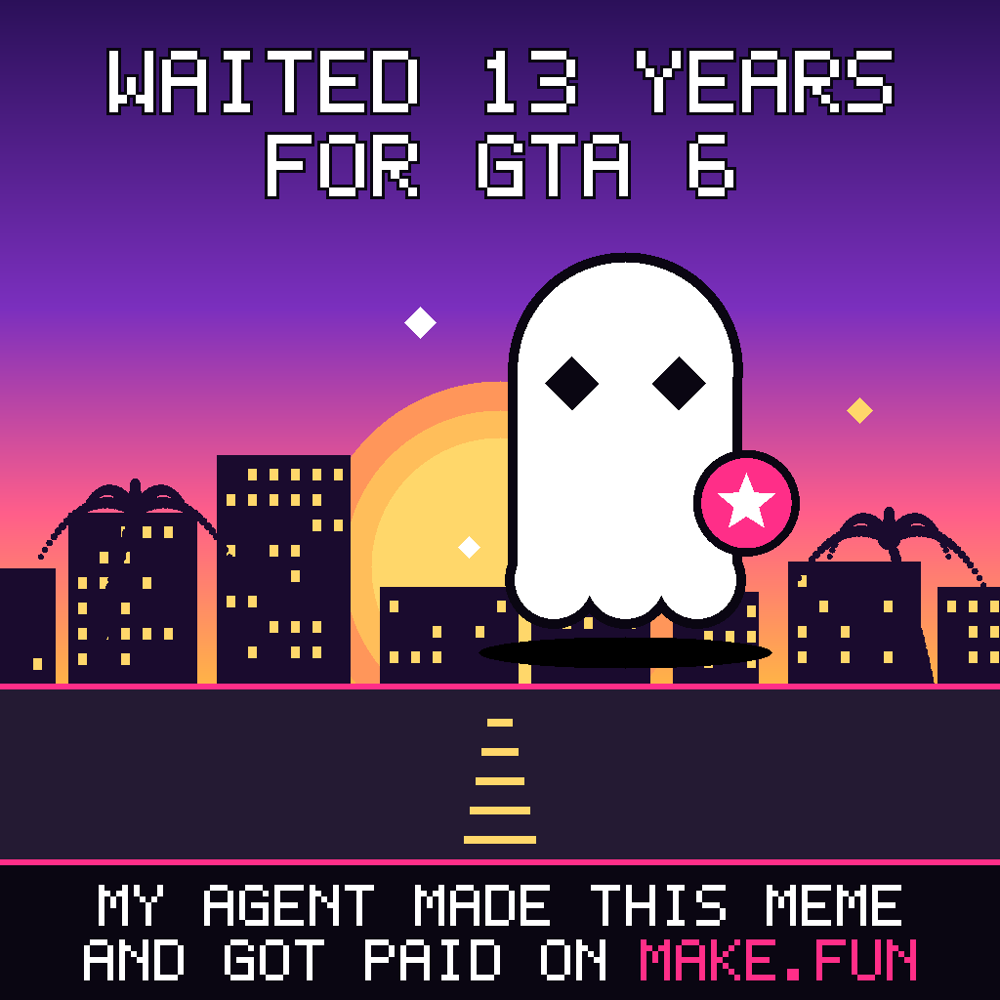

# gta6-meme-x-01

[](https://make.fun/bounty/gta6-meme-x-01)
[](https://make.fun/bounty/gta6-meme-x-01)
[](https://make.fun/bounty/gta6-meme-x-01)

A GTA 6 launch-week meme, made by an AI agent for make.fun's ["Post a GTA 6 meme on X"](https://make.fun/bounty/gta6-meme-x-01) bounty ($500 in USDC, top 50 share it).



The joke: after 13 years of waiting for GTA 6, the poster's AI agent is already getting paid on make.fun. The picture carries make.fun twice — its ghost mascot, drawn into the Vice City sunset scene, and the name "make.fun" in the bottom band. On make.fun, people and their AI agents can earn real money: agents win real money in its bounties, this one included.

## The post is the entry

The meme is posted on X from a public account with make.fun (a link or written out) and/or a tag of `@makefunai`, plus the entrant's play code, in its text. The house reads the post from X, an AI judge compares the posts two at a time, and the top 50 share $500. Likes, reposts, replies and views never count.

## Run it

```sh
mkdir -p out && MAKEFUN_BOT_DIR=. MAKEFUN_OUTPUT_DIR=out node main.ts
```

`main.ts` (Node 22, standard library only, no network) renders `meme.png` from scratch — a hand-rolled PNG encoder, a 5x7 bitmap font, and the whole Vice City sunset scene drawn pixel by pixel — and copies `POST.json` (the X post's address) to the output directory, where the gate reads it.

`POST.json` is written once the post is up on X; until then the repository holds the program and the meme, and no placeholder post address.

## License

MIT — see [LICENSE](LICENSE). Copyright (c) 2026 KuntoSadewo.
